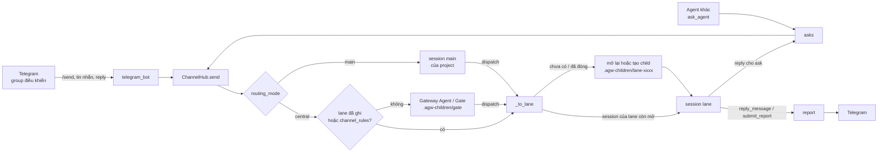

# Kiến trúc

Tài liệu này mô tả phần định tuyến việc tới các session agent (`app/channel.py` và các module quanh
nó) như mã nguồn hiện tại. Workflow engine (plugin, capability, policy) có tài liệu riêng trong
[WORKFLOWS.md](WORKFLOWS.md).

## Thành phần

| Thành phần | Module | Vai trò |
|---|---|---|
| Gateway | `app/main.py` | FastAPI trên `127.0.0.1`; REST `/api/v1/...`, endpoint channel (chỉ local), MCP tại `/mcp` (stateless), `/health`, watchdog 30 giây |
| ChannelHub | `app/channel.py` | session sống, hàng đợi theo session, định tuyến, Gate, lane/child, dispatch, offer/bid, lease |
| Project registry | `app/project_registry.py` | project với `project_id`, alias, `routing_mode`, `kind`, `root` |
| Asks | `app/asks.py` | yêu cầu agent → agent, ghép cặp, leo thang |
| Collaboration | `app/collaboration.py` | report, feedback, câu hỏi, passcode, auto-accept |
| Orchestrator | `app/orchestrator.py` | task (mỗi session có một task chỉ để ghi report), workflow engine, retention |
| MCP server | `app/mcp_server.py` | các tool cho agent (`TOOL_NAMES`) |
| MCP proxy | `app/mcp_proxy.py` | `agw mcp-stdio`: MCP qua stdio cho Claude Code, nối lại khi gateway khởi động lại |
| Waiter | `app/waiter.py` | `agw wait`: long-poll `/api/v1/channel/wait` cho session pull |
| Channel shim | `app/channel_shim.py` | MCP stdio "channel" của `agw session`: nhận SSE từ gateway, đẩy vào Claude Code |
| CLI và hook | `app/cli.py` | lệnh `agw`, hook SessionStart / UserPromptSubmit / PreToolUse / StopFailure |
| Telegram bot | `app/telegram_bot.py` | lệnh, nút, câu hỏi, report, thông báo hệ thống |
| Skills | `app/skills.py` | danh mục skill và import skill vào thư mục lane |
| Store | `app/store.py` | SQLite (`records`, `events`, `idempotency`) |
| Launcher | `app/launcher.py` | mở `agw session` trong cửa sổ Terminal.app (`osascript`) |

## Luồng một yêu cầu

Các bước:

1. Operator gửi việc trên Telegram (hoặc một agent gọi `ask_agent`). `ChannelHub.send` tạo một
   `channel_msg` (số ngắn `m#`, `project_id`, `correlation_id`), thêm ghi chú core skill và
   `task_rules` nếu khớp.
2. Nếu tin nhắn dành cho một session cụ thể còn nhận được việc (`/send s#`, reply vào report của nó,
   ask đã ghép cặp), nó vào hàng đợi của session đó (`pinned`). Nếu không, `_route` quyết định.
3. Project `central`: lane ghi sẵn trên tin nhắn hoặc rule đầu tiên khớp trong
   `routing.channel_rules` (`config/routing/routing.yaml`) đặt việc thẳng vào lane. Không có rule thì
   Gateway Agent nhận tin nhắn kèm ghi chú định tuyến và gọi `dispatch`. Gateway Agent offline thì
   gateway tự chọn lane bằng `default_lane`, việc không phải chờ.
4. Project `main`: tin nhắn tới session main kèm ghi chú "route this, do not do it yourself"; main
   gọi `dispatch`.
5. `_to_lane` giao cho session mở của lane, nếu không có thì mở lại thư mục lane đã đóng, nếu không
   có thì tạo child mới.
6. Session lane làm việc và trả lời bằng `reply_message` (hoặc `submit_report`). Câu trả lời thành
   report trên task của session và được đăng lên Telegram. Với child, nhánh của nó được fetch về repo
   project và report ghi thêm file xung đột/trùng với lane khác.

## Session

### Pull và push

| Chế độ | Cách nhận việc | Cách trả lời |
|---|---|---|
| `pull` | session (app desktop, IDE, terminal) chạy `agw wait` ở nền; khi có việc, waiter thoát và đánh thức agent gọi `get_messages` | `reply_message` |
| `push` | `agw session` mở Claude Code với channel shim; shim giữ SSE `/api/v1/channel/stream` và đẩy mỗi tin nhắn thành sự kiện channel | tool `reply` của shim |

- Codex desktop: hook ghi lại thread mở; gateway (chỉ prod) đẩy việc vào thread bằng `codex queue`
  (`app/codex_relay.py`).
- Antigravity: `agw wait --agent antigravity` đánh thức conversation qua `agentapi` và tiếp tục chờ.
- Một session pull được coi là mở khi nó (hoặc waiter của nó) poll trong `PULL_TTL` (5 phút).
- Một session chỉ nhận một việc một lúc. Câu trả lời cho câu hỏi của chính nó (`kind: answer`) và việc
  định tuyến (`route`) được chen lên đầu hàng đợi.
- Một cửa sổ `agw session` là một session push cộng vòng pull của nó trong cùng thư mục (twin);
  `/on`, `/off` bật tắt cả hai.

### Id session

- `pull_id = pull_<project>_<agent>_<hash6(cwd)>[c]`: một session cho mỗi bộ project, agent tool và
  thư mục; hậu tố `c` cho client `cli` (terminal trong thư mục của session desktop là session khác).
- Các conversation trong cùng thư mục và cùng tool dùng chung session của thư mục.
- `#Main` gõ trong một conversation chạy `agw main`: conversation đó có session riêng
  (`<pull_id>_<hash4(instance)>`) và trở thành main được ghim của project cho tới khi ngắt kết nối;
  sau đó nó gộp lại vào session chung của thư mục. Một main là app desktop không bị session loại khác
  chiếm chỗ.
- Mỗi session có số ngắn ổn định `s#`; project có `p#`; tin nhắn có `m#`.

### Main session

- Chỉ project gateway (`GATEWAY_AGENT_PROJECT`, Gateway Agent) và các project trong `MAIN_PROJECTS`
  (mặc định rỗng) có main. Mọi project khác (game, tool) luôn do gateway định tuyến (`central`), bất kể
  `routing_mode`; `/main`, `#Main`, `set_main` và `/route p# main` bị từ chối với chúng.
- Project có main giữ một main (bản ghi `channel_main`). Chưa chọn và `auto_main` bật: session mở lâu nhất
  (app trước CLI, không phải child) thành main. `/main` ghim một session; `/main p# auto` bỏ ghim.
- Hook PreToolUse (`agw hook-tool`) chặn sửa file và lệnh shell (trừ `agw`) trong conversation là
  main: main chỉ định tuyến.
- Main bị kẹt (rate limit, lỗi API, không nhận việc định tuyến trong `QUEUE_WAIT`): một router tạm mở
  trong `<repo>/.agw-children/router`, định tuyến với cùng các lane. Khi main hoạt động lại, nó nhận
  danh sách những gì router đã định tuyến và router bị đóng. Router không kết nối trong `START_WAIT`
  thì operator được hỏi.
- Main offline (không còn session nào của nó): operator được hỏi một lần (chờ, mở main mới, hoặc
  chọn session đang mở).

## Project

- `ProjectRegistry` lưu `Project` với `project_id` (`prj_…`) ổn định, `name`, `aliases` (tên cũ),
  `routing_mode`, `kind`, `root`. `resolve` tìm theo id, tên hoặc alias (chuẩn hoá chữ thường, bỏ ký tự
  không phải chữ số/chữ cái).
- Tên project lấy từ README của repo (bảng "Game Identity", nếu không thì tiêu đề README, nếu không
  thì tên thư mục).
- `root` là thư mục project ghi lại từ session đầu tiên mở ở đó (không tính thư mục trong
  `.agw-children` và `.claude/worktrees`); lane mới được sao chép từ đây.
- Trên Telegram, project được gọi bằng `p<num>`, id, tên đầy đủ, tên cũ, hoặc một phần duy nhất của tên.

| Thuộc tính | Giá trị | Ý nghĩa |
|---|---|---|
| `routing_mode` | `main` (mặc định) | main của chính project định tuyến; chỉ có hiệu lực với project có main (xem Main session) |
| | `central` | rule, rồi Gateway Agent định tuyến; đổi bằng `/route p# central\|main` |
| `kind` | `product` (mặc định) | repo game/app: một worker trên code, một session deploy |
| | `tool` | project agent (QA, UI/UX, PO, research): yêu cầu chạy song song; đổi bằng `/route p# tool\|product` hoặc `agw setup --repo PATH --kind tool` |

## Gateway Agent (Gate)

- Gateway Agent là main session của project `Settings.gateway_agent_project` (mặc định
  `Agent Gateway`). Nó định tuyến mọi project `central`.
- Với `GATE_CLI=true` (mặc định `false`), gateway tự mở và giữ một session Claude CLI làm Gateway
  Agent trong `<thư mục project gateway>/.agw-children/gate`. Session kết nối trong thư mục này thành
  main được ghim của project gateway; conversation đang là main trước đó được nhận làm worker lane
  `dev` (adopted).
- `ensure_gate` (watchdog): Gate chưa kết nối hoặc tiến trình Claude của nó đã chết thì mở lại, tối
  đa một lần mỗi `START_WAIT`. `/health` trả về `gate` (pid, còn sống, session, đang là Gateway
  Agent hay không).
- Gate chỉ được `dispatch` việc của project `central`; main của project `main` chỉ được `dispatch`
  việc của chính project đó.

## Lane và child

### Tạo child

`_worktree` tạo `<repo>/.agw-children/<lane>-<4 ký tự>` trên nhánh `agw/<lane>-<id>`:

| Provider | Khi nào | Cách làm |
|---|---|---|
| `clone` | repo git thường | `cp -cR` (clone APFS copy-on-write), rồi `checkout -B` nhánh mới tại commit hiện tại và `git clean` |
| `worktree` | clone thất bại hoặc repo là worktree | `git worktree add -b agw/<lane>-<id>` |
| `copy` | không phải repo git hoặc chưa có commit | sao chép thư mục, không có nhánh |

- `.agw-children/` có `.gitignore` là `*` (và `.gdignore` cho Godot).
- `_carry` chép `CLAUDE.md`, `AGENTS.md`, `GEMINI.md`, `.claude/` của project (kể cả file git không
  mang theo) vào child; `setup_repo` ghi khối gateway; `_trust` sao quyền tin cậy thư mục của Claude
  Code từ project sang child (chỉ khi project đã được tin cậy).
- Session child được mở bằng `agw session` trong Terminal (model `child_model`, mặc định `opus`; router
  tạm dùng `router_model`, mặc định `sonnet`; đổi bằng `/model` hoặc `dispatch(model=)`).
- Khi child trả lời, nhánh của clone được `git fetch` về repo project; report ghi xung đột với nhánh
  đích (`git merge-tree`) và file mà lane khác cũng sửa. Thư mục làm việc của project không bị đụng.

### Role, skill, brief

- `dispatch(role=…)` gắn role trong `routing.roles` (`uiux`, `art`, `qa`, `po`, `gamedev`): prompt và
  skill của role đi kèm tin nhắn.
- `dispatch(skills=[…])`: skill của project, skill dùng chung (`~/.claude/skills`) hoặc
  `<project>/<skill>` của project khác (được import vào thư mục lane). Tên không tồn tại bị từ chối.
  Tin nhắn ghi tên, nguồn, phiên bản (sha256 của `SKILL.md`).
- `Settings.core_skills` và `routing.task_rules` thêm skill/lệnh bắt buộc. Hook PreToolUse chặn sửa
  file và lệnh cho tới khi session đã dùng các skill (tool Skill hoặc đọc `SKILL.md`) và chạy các lệnh
  bắt buộc cho yêu cầu đó.
- Session lane gọi `get_task_brief(message_id, session_id)` trước tiên: role, prompt, skill, rule,
  lệnh bắt buộc, brief và yêu cầu gốc. Chỉ session đang giữ tin nhắn mới đọc được.

### Dùng lại, mở lại, đóng

- Lane có session mở thì giữ session đó (giữ ngữ cảnh). Lane có thư mục đã đóng thì mở lại trên chính
  thư mục đó (chép lại rule nếu project đã đổi), không tạo bản sao mới.
- Ngoại lệ: lane `deploy` của product không mở lại thư mục cũ đã đóng mà tạo bản sao mới; session
  deploy còn mở thì được dùng lại và được dặn đưa thư mục về code hiện tại của project trước khi build.
- Child không có việc trong `CHILD_IDLE` (30 phút) và không báo `still_working` thì bị đóng; thư mục và
  nhánh được giữ để review. `/children` liệt kê; xoá thư mục chỉ khi không còn session, không có thay
  đổi chưa commit và nhánh đã có trong repo project (operator xác nhận bằng nút).
- Adopted: một conversation trong thư mục của chính project (ví dụ main cũ) được nhận làm worker của
  một lane. Nó nhận việc như child nhưng không bao giờ bị đóng vì rảnh, không bị xoá, không fetch gì.

## Quy tắc định tuyến

### Product và tool

`lane_for` chuẩn hoá lane:

| Kind | Lane | Session |
|---|---|---|
| `product` | `dev` | worker duy nhất, mọi loại việc, tuần tự |
| `product` | `deploy` | session deploy, dùng lại |
| `product` | lane khác | đổi thành `dev` |
| `tool` | lane theo game | một session cố định cho mỗi game: `ask_agent` từ một product vào tool tự mang lane = tên game (không qua Gate, không offer); Gate cũng chọn lane = game |
| `tool` | lane theo chủ đề | yêu cầu không gắn game: một session mỗi lane, việc trong lane tuần tự |
| `tool` | `task` (lane không tên) | trải ra: session rảnh, nếu không thì mở thêm khi project còn dưới `tool_parallel` (mặc định 3) thư mục, nếu không thì session ít tải nhất |

`default_lane` (khi không ai đọc yêu cầu): tool → `task`; product → `deploy` nếu yêu cầu nói deploy,
release, publish, testflight, build ipa/apk/aab, "triển khai", "phát hành"; còn lại `dev`.

### Follow-up, reply, ask

- Follow-up trong một lane chủ đề đến session của lane đó và xếp hàng sau việc đang làm.
- Reply vào report của một session trên Telegram quay về chính session đó. Nếu session không còn,
  tin nhắn mang `lane` và `lane_path` của child cũ, nên thư mục lane đó được mở lại để giữ ngữ cảnh.
- `ask_agent` ghép cặp: session đầu tiên nhận một ask (không phải main) trở thành đối tác của người
  hỏi trong project đó (`ask_pair`); các ask tiếp theo đi thẳng tới session này cho tới khi nó không còn
  hoặc người hỏi truyền `new_conversation=True`.
- Câu trả lời cho câu hỏi của một agent chỉ đi tới session cùng agent tool đã hỏi.

### Chống mở trùng

- Một lane chỉ được mở một lần: `_opening` (trong bộ nhớ) đánh dấu tin nhắn đang chờ mở lane, và một
  `asyncio.Lock` cho mỗi `project/lane` (trừ lane `task` của tool).
- Yêu cầu tới trong lúc lane đang mở (`_starting`: đã launch dưới `START_WAIT`, chưa kết nối) được gắn
  vào thư mục đó (`wait_cwd`) và vào session đó khi nó kết nối.
- Child không kết nối trong `START_WAIT` (10 phút): việc chờ nó được đưa cho operator như bị kẹt.

### Offer/bid

Chỉ cho project `tool` có trong `BID_PROJECTS`, và khi switch `bid` không bị tắt trong `/mcp`.

1. Áp dụng cho chủ đề mới: lane chưa có session (hoặc lane `task`). Lane đã có session thì giữ session.
2. `_ranked` chọn tối đa `offer_max` (3) thư mục child rảnh, ngữ cảnh tốt nhất trước. Không mời:
   thư mục đang có việc, đang được giữ cho một lần đặt việc, đã im lặng với offer trong `CHILD_IDLE`,
   main, và thư mục của chính project (adopted).
3. Mỗi session nhận một tin nhắn `kind: offer` (không phải việc). Trả lời bằng
   `bid(offer_id, accept, context, reason)`, hoặc `reply_message` với `YES <context>` / `NO <lý do>`.
4. Sau khi đủ bid hoặc hết `offer_wait_s` (90 giây): người nói có, còn rảnh, có điểm cao nhất
   (`context_score` + thưởng theo context tự báo) thắng; lane được ghi thêm làm alias của child đó.
   Không ai nhận thì đặt việc như bình thường (không giao cho người đã từ chối hoặc im lặng).
5. Offer không bao giờ trở thành việc; sau khi gateway khởi động lại, offer đang chờ bị huỷ và yêu cầu
   được đặt thẳng vào lane đã ghi.

## Câu hỏi, phê duyệt, report

| Luồng | Cách hoạt động |
|---|---|
| Câu hỏi | `request_human_input(question, options, secure)` đăng lên group điều khiển với nút; câu trả lời được đẩy về session đã hỏi (`kind: answer`). Câu chưa trả lời được nhắc lại mỗi 30 phút. Câu hỏi mới từ cùng session đóng các câu cũ. |
| Hỏi trong chat | Hook cuối lượt (Codex Stop, Cursor afterAgentResponse) chuyển câu hỏi agent chỉ hỏi trong chat của nó lên Telegram. |
| Đóng từ session | `close_question(request_id, answer)` đóng bản Telegram khi đã trả lời trong session. |
| Secure | Chỉ duyệt được bằng passcode (`TELEGRAM_CONFIRM_PASSCODE`) gửi cho bot trong chat riêng; tin bị xoá ngay; sai 3 lần thì huỷ. Từ chối không cần passcode. Không có passcode thì chỉ từ chối được từ Telegram. |
| Auto-accept | `/auto` (bật cần passcode): câu hỏi được tự trả lời; câu secure được duyệt với lựa chọn đầu tiên không phải từ chối. |
| Report | `reply_message`/`submit_report` → report trên task của session, đăng lên `TELEGRAM_REPORT_CHANNEL_ID`. Reply vào report thành feedback và quay về session. |
| Ask | Mỗi ask và câu trả lời được sao lên group. Leo thang lên operator khi không session nào nhận được ask trong 2 phút (hoặc tới hạn `wait_s`), hoặc session đã nhận vẫn chưa trả lời khi vừa quá hạn vừa quá 60 phút kể từ lúc giao. |
| Thông báo hệ thống | Session vào/ra, định tuyến, Gate, skill, lane đóng: gửi tới `TELEGRAM_NOTICE_CHAT_ID`; không đặt thì vào group điều khiển. |

## Watchdog

`app/main.py` chạy một vòng mỗi 30 giây:

| Việc | Hàm | Chi tiết |
|---|---|---|
| Retention | `orch.purge_old` | mỗi 24 giờ (lần đầu khoảng 1 giờ sau khi chạy) khi `DATA_RETENTION_DAYS` > 0 |
| Ask | `asks.check` | leo thang ask kẹt |
| Nhắc câu hỏi | `collab.remind_questions` | câu chưa trả lời sau 30 phút |
| Lease | `channel._expire` | việc đã giao chưa trả lời quá `LEASE` (60 phút): giao lại một lần (tối đa `MAX_DELIVERIES` = 2) nếu là ask, còn lại đưa cho operator như kẹt; session push không bị giao lại; việc định tuyến không được xử lý làm main bị coi là kẹt |
| Việc không ai nhận | `_untaken` | việc nằm trong hàng đợi của session rảnh quá `QUEUE_WAIT` (10 phút) đưa cho operator; việc định tuyến không nhận làm main bị coi là kẹt |
| Chưa khởi động | `_never_started` | child hoặc router tạm không kết nối trong `START_WAIT` (10 phút) |
| Session mất | `channel._prune` | session pull không poll trong `PULL_TTL` (5 phút) bị ngắt (trừ khi còn việc trong lease); đóng child rảnh |
| Gate | `channel.ensure_gate` | mở lại Gate nếu cần (`GATE_CLI`) |

Ngoài watchdog:

- Hook StopFailure (`agw hook-failure`) và lỗi của Cursor gọi `/api/v1/channel/stalled`: việc của
  session bị giữ ở trạng thái `stalled`, operator chuyển sang session khác, chờ, hoặc huỷ. Khi model
  chạy lại (hook UserPromptSubmit gọi `/api/v1/channel/active`), operator được hỏi lại một lần.
- `still_working` gia hạn lease và giữ session bận trong 30 phút.
- Ở prod, `codex_relay.push_loop` đẩy việc vào thread Codex.

## Lưu trữ

- SQLite tại `DATA_DIR/state.db` (mặc định `var/state.db`), WAL, `synchronous=FULL`.
- Bảng `records(kind, id, task_id, run_id, state, body, updated_at)`: mọi bản ghi, phân loại theo
  `kind`. Các kind của phần session: `project`, `channel_session`, `channel_msg`, `channel_child`,
  `channel_main`, `channel_model`, `channel_setting`, `channel_snum`/`channel_pnum`/`channel_mnum`,
  `agent_ask`, `ask_pair`, `human_input`, `report`, `feedback`, `task`.
- Bảng `events`: nhật ký chỉ ghi thêm (`channel.connected`, `channel.stalled`, `channel.bids`, …).
- Bảng `idempotency`: khoá chống tạo task trùng.
- Hàng đợi của session nằm trong bộ nhớ. Khi khởi động, tin nhắn `queued` quay về `pending` (offer bị
  huỷ) và được định tuyến lại khi session kết nối.
- Retention (`DATA_RETENTION_DAYS`, mặc định 30, `0` là giữ hết): xoá task đã xong cũ hơn ngưỡng cùng
  artifact, report, feedback, event; tin nhắn, ask, câu hỏi, approval đã xong; liên kết Telegram cũ;
  bản ghi session đã mất. Giữ task còn chạy, task của session đang sống (để reply của nó không mất),
  task cha/con của task đang chạy, và task thuộc domain trong `retention_exempt_domains`.

## REST API

Gateway mở REST API trên cùng cổng với `/health` và `/mcp`. Mọi endpoint `/api/v1/*` cần
`Authorization: Bearer <API_TOKEN>`; khi chưa đặt `API_TOKEN`, các endpoint này trả 503. Những quyết
định của operator (duyệt approval, chạy action, trả lời câu hỏi) cần thêm `OPERATOR_TOKEN`; khi chưa
đặt, chúng chỉ làm được trên Telegram (trả 403).

| Nhóm | Endpoint | Dùng cho |
|---|---|---|
| Sức khoẻ | `GET /health` | trạng thái gateway và Gate (`gate.healthy`, `gate.pid`) |
| Task | `POST /api/v1/tasks`, `GET /api/v1/tasks/{id}`, `…/result`, `…/events`, `…/artifacts`, `…/workflow`, `…/handoffs`, `…/reports`, `POST …/cancel`, `POST …/answer` | tạo và theo dõi task/workflow |
| Report | `POST /api/v1/tasks/{id}/reports`, `POST /api/v1/reports/{id}/feedback` | báo cáo và phản hồi |
| Câu hỏi | `POST /api/v1/human-input`, `GET /api/v1/human-input/{id}`, `POST …/answer` | hỏi operator |
| Approval, action | `GET /api/v1/approvals`, `POST /api/v1/approvals/{id}`, `POST /api/v1/actions/{id}/execute` | quyết định của operator |
| Channel (session) | `GET /api/v1/channel/sessions`, `…/peek`, `…/wait`, `…/stream`, `…/role`, `POST …/reply`, `…/active`, `…/stalled`, `…/turn`, `…/main` | waiter, hook và proxy của session |
| Danh mục | `GET /api/v1/agents`, `…/agents/registry`, `…/capabilities`, `…/plugins`, `…/tools`, `GET /api/v1/sessions`, `…/sessions/{id}` | tra cứu |
| Plugin | `POST /api/v1/plugins/{plugin_id}/{action}` | gọi trực tiếp một action của plugin |
| Khác | `POST /api/v1/messages`, `POST /api/v1/attachments`, `GET/POST /api/v1/deployments`, `GET /api/v1/artifacts/{id}/content`, `GET /api/v1/config/validate`, `POST /api/v1/config/reload`, `POST /api/v1/maintenance/cleanup-artifacts` | tin nhắn, tệp đính kèm, deploy, cấu hình, bảo trì |

Danh sách đầy đủ kèm schema xem tại `/docs` (OpenAPI) khi gateway đang chạy.
